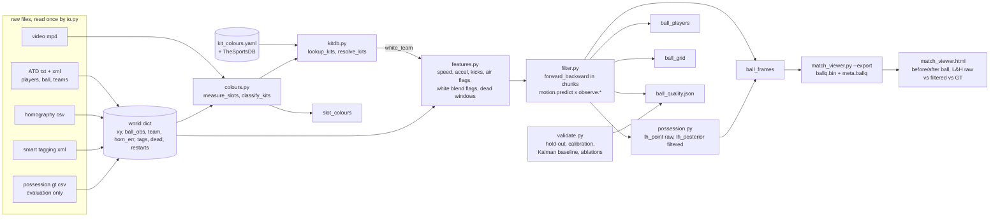

# ballq: the ball as a probability map

`ballq` turns the detector's ball point into a probability distribution over the pitch for every
frame, reconciles it with physics, the players and the match events, and gives the possession
heuristic (Link and Hoernig) that distribution instead of a point. Nothing in it is learned from
this match and nothing uses a hand label (rule 1). There is no seed: the same input always gives
the same output.

It works for any match that comes with the same file types: ATD tracking (txt + xml), a homography
csv, a video. Team names and sides are read from the ATD xml. No club name appears in the code.

Nothing to install by hand: the first run installs numpy, pandas, scipy, pyyaml and opencv into
your user profile, the same way `match_viewer.py` does. Open a terminal in the folder that holds
the repo root (it holds `ballq/`, `match_viewer/` and `data/`):

```
python -m ballq inspect --source tactical              # reads every input once and reports what it found
python -m ballq test                                   # 33 tests, about 10 s (installs pytest)
python -m ballq run --source all                       # whole match, both feeds, ~45 min each at 0.25 m cells
python -m ballq run --source tactical --start 11185 --end 18684    # the labelled 5 minutes only, ~3 min
python -m ballq validate --source tactical --start 11185 --end 18684
python match_viewer/match_viewer.py --dual --mode full --export --serve   # both feeds, synced, with the filtered ball
```

`python -m ballq ...` is the same thing. `data/` is found on its own (next to the script, one
level up, or `MTAH_DATA_DIR`); `--data FOLDER` overrides. Outputs go to `out/<source>/` at the repo root, where the viewer's export looks for them.

## Submission file

```
python -m ballq submit --quick               # base L&H on the raw tracking + dead_ball.json, about a minute, no filter run
python -m ballq submit                       # filtered and raw L&H from out/tactical (needs the whole-match run)
python -m ballq submit --dead path/to/our_dead_ball.json
```

Runs of one team shorter than `--min-spell-s` (1 s) with the same team on both sides are absorbed
before writing (`ballq/smooth.py`), because the scorer counts possessions and a blip costs twice:
an unmatched spell and a true possession cut in two. Runs next to a dead ball or at a real change
are kept whatever their length. The viewer's SUBMISSION row applies the same rule.

`--quick` reads the tracking, runs the Link and Hoernig heuristic on the detector's ball point for
all 199,319 frames, merges the dead-ball intervals and writes `out/submission_lh_raw.csv`: the
check-results run. Without `--quick` it reads `ball_frames` from the full pipeline run and writes
both files.

Writes `out/submission_lh_filtered.csv` and `out/submission_lh_raw.csv`, one row per tactical frame
(`frame,label`, SUBMISSION.md format): `D` inside our dead-ball intervals, otherwise the Link and
Hoernig team from `ball_frames` (filtered ball, or raw ball), `X` where neither says anything. The
dead-ball file is the team json (`timelines.tactical.dead_ball` as `[first, last]` pairs), a bare
list of pairs, or a csv with `first,last`. It prints label counts, accuracy against the public GT
including `D`, recall and precision per label, then runs the official
`evaluation/validate_submission.py` on each file and, for the files that pass, `run_evaluation.py`
(scoreboard and per-file reports in `out/evaluation/`; `--no-score` skips it). The dead-ball file
is found by name: any `*dead*.json` or `*dead*.csv` under the data root, or `--dead PATH`. `ballq/submit.py` holds the four functions; nothing in it reads the GT except the score line.

## Pipeline



Every box is a module; every arrow is a plain Python call or a file on disk. `ballq/__init__.py`
lists the modules in the order they run.

## What each module does

| module | functions | used by |
|---|---|---|
| `io.py` | `parse_atd_meta`, `build_decoder`, `read_atd`, `read_homography`, `read_tags`, `read_gt`, `load_world` | `cli.run`, `cli.validate` |
| `grid.py` | `Grid(pitch_m, cell_m)`: `cell`, `centre`, `window`, `gaussian_bump`, `mass_within`, `mean_cov`, `entropy_bits` | everything below |
| `features.py` | `ball_speed_frames`, `ball_accel`, `kicks_from_accel`, `nearest_player_m`, `air_ball_flags`, `white_blend_flags`, `dead_windows` | `filter.prepare`, `io.load_world` |
| `colours.py` | `shirt_point`, `sample_patch_lab`, `measure_slots`, `classify_kits`, `is_light` | `cli.cmd_colours` (option 2: measure from video) |
| `kitdb.py` | `FileKitDB`, `HttpKitDB`, `lookup_kits`, `resolve_kits`, `hex_to_lab` | `cli.cmd_colours` (option 3: kit database) |
| `motion.py` | `rolling_kernel_sigma`, `predict` | `filter._step` |
| `observe.py` | `trust`, `gate_tau`, `detector_likelihood`, `holder_likelihood`, `holder_candidates`, `restart_prior` | `filter._likelihood` |
| `filter.py` | `prepare`, `forward_backward`, `run_chunked` | `cli.run`, `validate` |
| `possession.py` | `lh_point` (raw ball), `lh_posterior` (filtered ball) | `cli.run`, `validate.gt_agreement` |
| `contract.py` | column lists, `validate_frames`, `validate_players`, `write_table`, `read_table`, `config_hash`, `write_quality` | `cli`, consumers |
| `validate.py` | `holdout_mask`, `holdout_scores`, `kalman_baseline`, `kalman_holdout`, `ablations` | `cli.validate` |
| `submit.py` | `read_dead_intervals`, `dead_mask`, `build_labels`, `score_against_gt`, `write_submission` | `cli.submit` |
| `cli.py` | `paths_for`, `cmd_inspect`, `cmd_colours`, `cmd_run`, `cmd_validate`, `cmd_submit`, `main` | `python -m ballq` |

### The model in one paragraph

The pitch is a grid of 0.25 m cells (`grid.cell_m`). Per frame the filter predicts where the ball
can be from the previous frame (`motion.predict`: a mixture of rolling on with the last velocity
plus speed dependent blur, sitting at the feet of a player within 2 m of the current mass, and a 3 %
uniform leak), then multiplies in what was seen (`observe`): the detector point as
`(1 - tau) + tau * Gaussian(sigma)`, where `trust()` lowers `tau` on air-ball frames, white-shirt
blends, bad homography frames and `gate_tau()` lowers it when the point is unreachable compared with
where the filter already is; the nearest players as a second, weaker observation
(`holder_likelihood`); and a nudge to the restart spot at the end of a kick-off tag
(`restart_prior`). The same is run backwards and the two are multiplied (forward-backward
smoothing), in chunks of 600 frames with 150 frames of overlap so a whole match fits in memory.
Each frame leaves a mean, a covariance, an entropy, the mass within 1 m and 2 m of every player,
and the cells that hold more than 0.2 % of the mass.

### Team colours (options 2 and 3 together)

1. `colours.measure_slots` projects each tracked player into 300 sampled video frames with the
   homography, moves up the image by about a shirt height and takes the median Lab colour of a
   small patch. `classify_kits` takes the median per team, decides which team (if any) wears a
   light kit (`white_lightness_min`, `white_chroma_max`), flags slots closer to the other team's
   colour (`mislabel`) and slots far from both (`third`: goalkeepers, the referee, bad tracks).
2. `kitdb.lookup_kits` asks `ballq/kit_colours.yaml` (offline, by team name as it appears in the
   ATD xml, tolerant of "FC" prefixes) and, failing that, TheSportsDB's free endpoint, for the home,
   away and third kit colours. `resolve_kits` names the kit each team is wearing (closest to the
   measured colour), lets the video decide the light team when it can, falls back to the database
   when it cannot, and records notes when the two disagree. `colours.override_white_team` in the
   config skips both.

The result feeds `features.white_blend_flags`: a detector point within 1 m of a light-kit player
gets lower trust, because that is where the detector loses the ball.

## Outputs (`out/<source>/`)

Parquet when `pyarrow` is installed, otherwise gzip CSV with the same columns. Read either with
`ballq.contract.read_table("out/tactical/ball_frames")`.

**ball_frames**, one row per video frame
| column | meaning |
|---|---|
| `frame` | video frame (0 based, the ATD line id minus one) |
| `mean_x`, `mean_y` | posterior mean in pitch units 0..1 |
| `sd_x`, `sd_y`, `corr` | posterior spread in metres and the correlation |
| `entropy_bits` | how spread out the posterior is (0 = one cell, 16.8 = uniform) |
| `p_observed_trusted` | `tau` used on this frame (0 when the detector had no point) |
| `p_air`, `p_dead` | air-ball flag, dead-ball window (0/1) |
| `p_carried` | highest mass within 2 m of any player |
| `holder_slot`, `holder_p` | Link and Hoernig holder on the filtered ball and the mass within `tp` of them |
| `source_flags` | bits: 1 lost, 2 air, 4 white blend, 8 homography bad, 16 restart prior, 32 dead |
| `lh_raw_team`, `lh_post_team` | possession team from the raw ball and from the filtered ball (H/A/X) |
| `raw_x`, `raw_y`, `speed_frames`, `kick` | the detector point, its speed, kick frames, for comparison |

**ball_players**, one row per (frame, slot) for slots within 5 m of the mean or with mass within 2 m:
`frame, slot, team, dist_mean_m, p_within_1m, p_within_2m, p_holder`.

**ball_grid**, the sparse posterior: `frame, cell_x, cell_y, p` for cells with `p >= grid.mass_min_out`.

**slot_colours**: `slot, team, L, a, b, d_own, d_other, mislabel, third, n_samples` (Lab on the OpenCV scale).

**ball_quality.json**: `ballq_version`, `config_hash`, `git_commit`, frame range, fractions lost /
air / white, `white_team` and the full colour decision (`colours.video`, `colours.database`,
`decided_by`, `notes`), `mean_entropy_bits`, `median_sd_m`, GT agreement of both heuristics,
runtime, and after `validate`: hold-out error, calibration, Kalman baseline and ablations.

### How to consume

```python
from ballq.contract import read_table
f = read_table("out/tactical/ball_frames")
# a possession label per frame from the filtered ball
labels = f.set_index("frame")["lh_post_team"]
# frames where the detector was not believed
suspect = f[f.p_observed_trusted < 0.5]
# the ball's probable position for a feature: mean, or sample the grid
g = read_table("out/tactical/ball_grid")
cells = g[g.frame == 12345]            # cell_x, cell_y, p   (sums to about 1)
# who could have the ball, with probabilities
p = read_table("out/tactical/ball_players")
p[p.frame == 12345].sort_values("p_within_1m", ascending=False).head(3)
```

Anything downstream should treat `mean` as a summary and prefer `p_within_*` or the grid where it
matters: when `entropy_bits` is high the mean sits between two candidates and means little.

## Validation without labels

`python -m ballq validate` on a window:
- **hold-out**: hides the detector point for one second in every ten; the filter must fill the gap
  from physics and players. Reports median and p90 error against the hidden points (clean frames
  only) and whether the stated covariance is honest: the fraction of hidden points inside the 1 and
  2 sigma ellipses should be near 0.39 and 0.87.
- **Kalman baseline**: a constant velocity Kalman smoother on the same hidden input, the number to beat.
- **ablations**: `no_holder`, `no_gate`, `no_air_flag`, `no_restart_prior`, each rerun and
  compared on GT agreement of the filtered heuristic and mean entropy.
- the unit tests (`tests/`) run the whole chain on a synthetic match with a known truth: a lost ball
  is recovered to within 3 m, a 26 m air-ball excursion is discounted, kicks are found, outputs stay
  in 0..1, and two runs are identical.

GT agreement is reported for both heuristics from `ball_quality.json` and live in the viewer; it is
read-only evaluation, nothing is tuned on it and nothing in the filter reads it
(`features.dead_from_gt` is false and stays false for the challenge). Dead-ball windows come from
the set-piece tags that ship with the data.

## The viewer

`match_viewer.py --export` reads `out/<source>/ball_frames.*` (or `--ballq DIR`, `--ballq none`),
writes `ballq.bin` next to `data.bin` and adds `ballq` to `meta.json`. The page then shows:
- the filtered ball as a cyan disc with its 1 sigma ellipse and a dashed link to the detector point
  (layers "ball (filtered)" and "detector to filtered link");
- the probability map itself on the video: every grid cell above 0.2 % mass as a dark blue patch on
  the ground, darker where the mass is higher (layer "ball probability map"). The cells come from
  `out/<source>/ball_grid.bin` (uint16 row, col, mass per cell) with `ball_grid_index.bin` (one byte
  offset per frame); the export copies the window into `grid.bin` + `grid_index.bin` and the page
  fetches one frame at a time with a Range request, so a full match costs nothing until you seek into it;
- rows `L&H FILTERED` and `DISAGREE` (green where the filtered heuristic matches GT and the raw one
  does not, red the other way), a `ball filter` group with `BALL MOVED`, `BALL SD`, `TRUST` and the
  flag rows; the `ball filter` row preset;
- the header panel with GT agreement of L&H on the raw and on the filtered ball, the frames each
  one alone gets right, the number of places the filter moved the ball more than 2 m, the light kit
  and the config hash;
- candidate lists "L&H raw vs filtered" and "filter moved the ball > 2 m";
- with `dead_ball.json` next to `match_viewer.py` (or `--dead PATH`): rows `DEAD OURS`, `SUBMISSION`
  (D where we say dead, else filtered L&H) and `SUB ≠ GT` in the colour of what GT says, the
  `submission` row preset, the submission label and its GT score in the heuristics card, dead-ball
  recall and precision in the agreement panel, and candidate lists "GT ≠ submission" and
  "our dead ball ≠ GT dead".
Team names come from the ATD xml through `meta.team_names`.

## Configuration

Everything tunable is in `ballq/config.yaml`, with a comment per key. `config_hash` in the quality
file records which one produced an output. The parts that matter most: `grid.cell_m` (0.25 m,
runtime scales with cells), `motion.weights`, `observe.*_tau` (how far a flag lowers trust),
`observe.gate_ratio_min`, `possession.tp_m` and `ta_m` (Link and Hoernig radii), `colours.*`.
